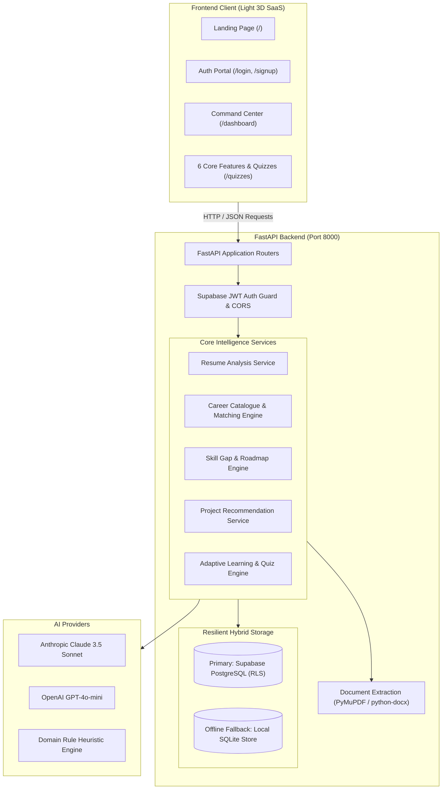

<div align="center">

# ⚡ PATHFORGE AI
### *Forge Your Future. One Skill at a Time.*

**The Next-Generation AI Career Pivot Coach & Continuous Learning Intelligence System**

[](https://fastapi.tiangolo.com)
[](https://www.python.org/)
[](https://supabase.com)
[](#-the-light-3d-experience)
[](https://render.com)
[](#-license)

<br/>

> *"Your career is not a straight highway; it’s an evolving canvas. PATHFORGE AI transforms the chaos of career transitions into a clear, empowering, step-by-step adventure."*

<br/>

[🌟 Experience Tour](#-experience-tour) •
[🚀 The Six Core Pillars](#-the-six-core-pillars) •
[🏛️ System Architecture](#️-system-architecture) •
[⚡ 3-Minute Quickstart](#-3-minute-quickstart) •
[🎨 Light 3D Design Tokens](#-the-light-3d-experience) •
[📡 API Reference](#-api--route-reference)

---

</div>

## 🌌 Welcome to PATHFORGE AI

Are you a **computer science student** seeking your first software engineering role?  
A **senior developer** pivoting into Machine Learning or Cloud Architecture?  
Or a **career changer** navigating modern tech with zero guesswork?

**PATHFORGE AI** is designed specifically for you.

Traditional resume analyzers stop at keyword counts and generic advice. PATHFORGE AI takes a radically different, agentic approach:
1. **Verifies Ground-Truth Evidence**: Scans your real resume to isolate demonstrated competencies without fabricated hallucinations.
2. **Matches 13 Modern Tech Trajectories**: Measures mathematical compatibility (35% to 96%) across frontend, backend, AI, DevOps, data science, and security.
3. **Isolates Exact Skill Gaps**: Breaks missing competencies into high-urgency, medium-priority, and good-to-have milestones.
4. **Builds an 8-Week Roadmap**: Converts vague goals into weekly sprints with interactive checklists and velocity meters.
5. **Architects Recruiter-Ready Projects**: Provides production-grade project blueprints (APIs, schemas, tests) tailored to bridge your exact gaps.
6. **Continuously Adapts to Your Growth**: Evaluates your retention through interactive topic quizzes and safely adapts your curriculum with your consent.

All packaged inside a **futuristic, ultra-fast, Light-Themed 3D SaaS experience** inspired by Apple Vision Pro, Linear, and Stripe.

---

## 🌟 Experience Tour

<div align="center">

```
  ┌────────────────────────────────────────────────────────────────────────┐
  │                           PATHFORGE AI ENGINE                          │
  │                                                                        │
  │   [ 📄 Resume Parser ]  ──▶  [ 🎯 Career Matcher ]                     │
  │            │                          │                                │
  │            ▼                          ▼                                │
  │   [ 🔍 Skill Gap Matrix ] ──▶ [ 🗺️ 8-Week Roadmap ]                    │
  │            │                          │                                │
  │            ▼                          ▼                                │
  │   [ 💼 Project Blueprints ] ──▶ [ ⚡ Adaptive Diagnostics & Quizzes ]  │
  └────────────────────────────────────────────────────────────────────────┘
```

</div>

### 🎯 Who is PATHFORGE AI Built For?

* 🎓 **Students & Fresh Graduates**: Turn academic coursework and classroom projects into verifiable skill signals that impress tech recruiters.
* 🔄 **Career Pivoters & Transitioners**: Discover how your current experience translates into adjacent high-paying roles (e.g., QA ➔ DevOps, Python Dev ➔ AI Engineer).
* 💼 **Working Professionals**: Target your next promotion or role switch with surgical precision instead of drowning in random YouTube tutorials.

---

## 🚀 The Six Core Pillars

PATHFORGE AI unites six mission-critical pillars into one frictionless workflow:

| Feature | Direct Route | Primary Capability | Why You Will Love It |
| :--- | :---: | :--- | :--- |
| **1. Intelligent Resume Analysis** | [`/resume-analysis`](#feature-1-intelligent-resume-analysis) | Multi-format PDF/DOCX parser extracting 9 structured dimensions with 0% hallucinations. | Upload your resume with drag-and-drop; instantly preview extracted skills, education, and projects. |
| **2. AI Career Pivot Coach** | [`/career-recommender`](#feature-2-ai-career-pivot-coach) | Evaluates your profile against 13 tech roles, surfacing the top 5 compatible tracks. | Transparent match percentages (35%–96%) with honest, explainable rationales. |
| **3. AI Skill Gap Analyzer** | [`/skill-gap-analyzer`](#feature-3-ai-skill-gap-analyzer) | 3-tier classification (*Skills You Have*, *Skills to Improve*, *Not Found*). | Stop guessing what to study. See the exact libraries, databases, and protocols you're missing. |
| **4. Personalized Roadmap** | [`/personalized-roadmap`](#feature-4-personalized-learning-roadmap) | Interactive 3D vertical timeline delivering 8 weeks of milestone-driven learning sprints. | Weekly actionable tasks with interactive checkboxes and live completion velocity. |
| **5. Targeted Portfolio Projects** | [`/project-recommendations`](#feature-5-targeted-portfolio-projects) | Full-stack project blueprints tailored to missing skills with architecture specs and tests. | Build projects that recruiters actually care about. Link your GitHub and live URLs. |
| **6. Adaptive Learning & Quizzes** | [`/adaptive-learning`](#feature-6-adaptive-learning-engine--quizzes) | Diagnostic radar, velocity metrics, and interactive 3-step quiz engine (`/quizzes`). | Measure your real mastery on any topic. Safely recalibrate your roadmap with one click. |

---

## 🎨 The Light 3D Experience

Say goodbye to gloomy dark dashboards and eye-straining neon contrasts. PATHFORGE AI is built on a custom **Light-Themed 3D Design System** engineered for clarity, focus, and visual delight.

<div align="center">

| Token | Hex | Swatch | Application & Visual Meaning |
| :--- | :---: | :---: | :--- |
| **Canvas Background** | `#F8FAFF` | `⚪` | Main body canvas: bright, airy, and distraction-free |
| **Elevated Surface** | `#EFF5FF` | `🔲` | Secondary cards, sidebar background, table headers |
| **Primary Blue** | `#4776FF` | `🟦` | Primary action buttons, active timeline nodes, primary branding |
| **Deep Navy** | `#172554` | `🪨` | High-contrast typography, crisp icons, dark accents |
| **Accent Sky** | `#75C8FF` | `🌐` | 3D glow rings, interactive card borders, focus rings |
| **Accent Violet** | `#A78BFA` | `🔮` | AI gradient highlights, badge glowing borders |
| **Text Primary** | `#172033` | `⬛` | Slate 900 high-legibility headings and body text |
| **Text Muted** | `#64748B` | `◽` | Slate 500 secondary labels, meta timestamps, subtitles |

</div>

### 🔮 What Makes the UI Feel Magical?
* **Zero-Dependency 3D Card Tilt**: Cards gently tilt toward your mouse pointer using buttery 60 FPS CSS transforms (`perspective(1000px) rotateX(...) rotateY(...) scale3d(1.02, 1.02, 1.02)`).
* **Glassmorphic Multi-Tier Depth**: Layered shadows (`0 20px 40px -15px rgba(23, 37, 84, 0.08)`) create an authentic sensation of floating tactile glass.
* **Responsive SaaS Shell**: Collapsible sidebar, sticky topbar with user status badges, floating toast notifications, and zero dead ends.

---

## 💻 Feature Deep-Dive

### Feature 1: Intelligent Resume Analysis
* **Multi-Format Processing**: Deep binary text extraction for `.pdf` (via PyMuPDF) and `.docx` (via `python-docx`).
* **Strict Security Guardrails**: 5 MB file size limit, binary magic byte checks (`%PDF-`, PK zip headers), password-protected file detection, and OCR warnings.
* **Nine Structured Dimensions**: Parses personal info, professional summary, technical skills, soft skills, education, work experience, projects, certifications, and extra achievements.
* **Hybrid Storage Architecture**: Persists to Supabase PostgreSQL (secured via Row Level Security), with automatic local SQLite offline caching.

### Feature 2: AI Career Pivot Coach
* **13 High-Demand Tech Tracks Supported**:
  `Full Stack Developer` • `Frontend Developer` • `Backend Developer` • `Python Developer` • `Software Developer` • `Data Analyst` • `Data Scientist` • `Machine Learning Engineer` • `AI Engineer` • `Cloud Engineer` • `DevOps Engineer` • `Cybersecurity Analyst` • `UI/UX Designer`
* **Explainable Match Justifications**: Synthesizes verified coursework, personal projects, and job history into realistic fit scores (35% to 96%) without inflated praise.
* **Fresher Friendly**: Rewards academic projects, hackathon prototypes, and self-taught portfolios even when formal commercial experience is 0 years.

### Feature 3: AI Skill Gap Analyzer
* **Three-Tier Classification**:
  * `Category A (Skills You Have)`: Concrete evidence found in work history or code repositories.
  * `Category B (Skills to Improve)`: Found in candidate profile, but lacking production-level depth.
  * `Category C (Not Found)`: Critical role prerequisites missing from the candidate's portfolio.
* **Priority Ranking**: Flags missing competencies by urgency (*High Priority*, *Medium Priority*, *Good to Have*) with plain-English rationales explaining *why* recruiters require them.

### Feature 4: Personalized Learning Roadmap
* **8-Week Structured Curriculum**: Automatically generated from your exact skill gaps and weekly study hours.
* **Three Core Phases**:
  * **Weeks 1–3 (Foundation)**: Core syntax, tools, protocols, and architectural fundamentals.
  * **Weeks 4–6 (Deepening & Integration)**: Real-world workflows, API integrations, and database schemas.
  * **Weeks 7–8 (Capstone & Production)**: End-to-end deployment, unit testing, and portfolio hardening.
* **Progress Tracking**: Interactive activity checkboxes with dynamic completion percentage calculation.

### Feature 5: Targeted Portfolio Projects
* **Gap-Targeted Blueprints**: Generates practical, recruiter-impressing project specifications built specifically to prove competence in missing skills.
* **Architectural Blueprints**: Includes component diagrams, database schemas, functional requirements, testing criteria, and deployment recommendations.
* **Showcase Portfolio Tracker**: Dedicated workspace to store active projects, track development statuses (*Planning*, *In Progress*, *Completed*), and link live demo and GitHub repository URLs.

### Feature 6: Adaptive Learning Engine & Quizzes
* **Velocity Metrics**: Visualizes roadmap completion percentage, active weekly tasks, completed projects, and average assessment score.
* **"What Should I Learn Next?" Card**: Analyzes current learning velocity to suggest the single highest-leverage activity for maximum momentum.
* **Interactive Stepper Quiz Engine**:
  * Accessible via `/quizzes` or topic pills inside the Adaptive Learning dashboard.
  * Generates 3-question targeted multiple-choice assessments for any tech topic (Python, Docker, SQL, React, etc.).
  * Complete stepper UI with progress bar, radio selection cards, instant scoring, circular gauge, and explanation breakdowns.
* **Safe Curriculum Adaptation**: Uncovers recurring weak areas and proposes non-destructive roadmap adjustments that users can accept or decline with a single click.

---

## 🏛️ System Architecture



---

## 🗂️ Project Directory Tree

```text
PATHFORGE-AI/
│
├── app/
│   ├── __init__.py
│   ├── main.py                  # FastAPI application, CORS, static mounting & web routes
│   ├── database.py              # Supabase client initialization & environment verification
│   ├── auth.py                  # JWT auth dependency & user-scoped client resolver
│   │
│   ├── routers/                 # Modular API endpoints
│   │   ├── auth_routes.py       # User registration, login, session & password reset API
│   │   ├── resume_routes.py     # Resume upload, parse, and retrieval API
│   │   ├── career_routes.py     # Career recommendations & target selection API
│   │   ├── skill_gap_routes.py  # Skill gap analysis & priority matrix API
│   │   ├── roadmap_routes.py    # Learning roadmap generation & progress API
│   │   ├── project_routes.py    # Project recommendation & portfolio links API
│   │   └── adaptive_routes.py   # Adaptive velocity, quiz generation & scoring API
│   │
│   ├── schemas/                 # Strict Pydantic v2 validation models
│   │   ├── resume_schema.py
│   │   ├── career_schema.py
│   │   ├── skill_gap_schema.py
│   │   ├── roadmap_schema.py
│   │   ├── project_schema.py
│   │   └── adaptive_schema.py
│   │
│   ├── services/                # Business logic & AI orchestration
│   │   ├── resume_service.py    # Document parsing & validation pipeline
│   │   ├── career_catalogue.py  # 13 industry role definitions & requirements
│   │   ├── ai_career_service.py # Career matching & score calculation engine
│   │   ├── ai_skill_gap_service.py # 3-tier classification & gap analysis
│   │   ├── roadmap_service.py   # 8-week structured roadmap generator
│   │   ├── project_service.py   # Portfolio project blueprint generator
│   │   ├── adaptive_service.py  # Quiz creation, scoring & roadmap adaptation
│   │   ├── ai_resume_service.py # Claude / OpenAI structured extractor & fallback
│   │   └── storage_manager.py   # Hybrid Supabase + SQLite persistence
│   │
│   ├── static/                  # Production frontend assets
│   │   ├── css/
│   │   │   ├── theme-3d.css     # Unified Light 3D design system & tokens
│   │   │   ├── resume_analysis.css
│   │   │   ├── career_recommender.css
│   │   │   └── auth.css
│   │   └── js/
│   │       ├── app-shell.js     # 3D tilt, auth listener, toasts, sidebar drawer
│   │       ├── auth.js          # Same-origin registration & login controller
│   │       ├── dashboard.js     # Command Center metrics loader
│   │       ├── resume_analysis.js # Resume upload & results rendering
│   │       ├── career_recommender.js # Career match explorer & modal
│   │       ├── skill_gap.js     # Skill gap breakdown & matrix
│   │       ├── roadmap.js       # Timeline interaction & progress tracker
│   │       ├── projects.js      # Portfolio projects & blueprint guide
│   │       ├── adaptive.js      # Adaptive feedback & adjustment resolver
│   │       ├── quizzes.js       # Dedicated stepper quiz engine
│   │       ├── profile.js       # Candidate profile manager
│   │       └── settings.js      # Learning preferences & cache reset
│   │
│   └── templates/               # Jinja2 HTML views (Light 3D SaaS)
│       ├── base.html            # Responsive master layout shell
│       ├── landing.html         # High-converting 3D landing page
│       ├── auth.html            # Split-screen 3D authentication portal
│       ├── dashboard.html       # SaaS Command Center dashboard
│       ├── resume_analysis.html # Feature 1: Resume Analyzer
│       ├── career_recommender.html # Feature 2: Career Pivot Coach
│       ├── skill_gap.html       # Feature 3: Skill Gap Analyzer
│       ├── roadmap.html         # Feature 4: Learning Roadmap
│       ├── projects.html        # Feature 5: Projects & Portfolio
│       ├── adaptive.html        # Feature 6: Adaptive Learning Engine
│       ├── quizzes.html         # Dedicated Interactive Quizzes Engine
│       ├── profile.html         # Candidate Profile & Career Track
│       └── settings.html        # Preferences & Settings
│
├── data/
│   └── pathforge_local.db       # Local SQLite fallback storage
│
├── migrations/                  # Supabase PostgreSQL DDL schemas
│   ├── 001_create_resume_analysis.sql
│   ├── 002_career_and_skills_system.sql
│   └── 003_complete_career_intelligence_system.sql
│
├── tests/                       # Automated test suite
│   ├── test_resume_analysis.py
│   ├── test_career_and_skill_gap.py
│   ├── test_features_3_4_5_6.py
│   └── test_live_supabase_integration.py
│
├── .dockerignore                # Docker ignore definitions
├── Dockerfile                   # Multi-stage production container
├── Procfile                     # Process file for Render / Railway / Heroku
├── render.yaml                  # 1-Click Render deployment blueprint
├── .env.example                 # Environment configuration template
├── requirements.txt             # Python project dependencies
├── run.py                       # One-click server launcher with browser auto-open
└── README.md
```

---

## ⚡ 3-Minute Quickstart

### Prerequisites
* **Python 3.10+** (Tested on Python 3.12 & 3.13)
* **Git**
* A free [Supabase](https://supabase.com) account (for PostgreSQL database & Auth)

---

### Step 1: Clone Repository
```bash
git clone https://github.com/VallabhDevale-tech/PATHFORGE-AI.git
cd PATHFORGE-AI
```

### Step 2: Create & Activate Virtual Environment
```bash
# Windows (PowerShell)
python -m venv venv
.\venv\Scripts\Activate.ps1

# macOS / Linux
python3 -m venv venv
source venv/bin/activate
```

### Step 3: Install Dependencies
```bash
pip install -r requirements.txt
```

### Step 4: Configure Environment Variables
Copy `.env.example` to `.env`:
```bash
cp .env.example .env
```

Open `.env` and configure your keys:
```env
# Supabase Configuration
SUPABASE_URL=https://your-project-id.supabase.co
SUPABASE_KEY=your-supabase-anon-or-publishable-key

# Optional: Supabase JWT Secret (for local zero-latency token verification)
SUPABASE_JWT_SECRET=your-supabase-jwt-secret

# AI Model Provider (Anthropic Claude OR OpenAI)
ANTHROPIC_API_KEY=your-anthropic-api-key
ANTHROPIC_MODEL=claude-3-5-sonnet-20241022

# Alternative: OpenAI
OPENAI_API_KEY=your-openai-api-key
OPENAI_MODEL=gpt-4o-mini
```
*(💡 Pro-Tip: Even without any OpenAI or Anthropic API key, PATHFORGE AI runs 100% out-of-the-box using its built-in domain heuristic fallback engine!)*

### Step 5: Database Setup (Supabase)
Run the SQL migrations in your **Supabase Dashboard -> SQL Editor**:
1. Execute `migrations/001_create_resume_analysis.sql`
2. Execute `migrations/002_career_and_skills_system.sql`
3. Execute `migrations/003_complete_career_intelligence_system.sql`

This creates all tables, indexes, and Row Level Security (RLS) policies guaranteeing user data isolation.

### Step 6: Launch Application
```bash
python run.py
```
This automatically boots the FastAPI server on `http://127.0.0.1:8000` and opens your default browser!

---

## 🌐 API & Route Reference

### Web Pages (Jinja2 HTML Views)
| Path | Method | View Description |
| :--- | :---: | :--- |
| `/` | `GET` | 3D Interactive Landing Page |
| `/login` / `/signup` / `/auth` | `GET` | Split-Screen 3D Authentication Portal |
| `/dashboard` | `GET` | SaaS Command Center Dashboard |
| `/resume-analysis` | `GET` | Feature 1: Resume Upload & Analysis Workspace |
| `/career-recommender` | `GET` | Feature 2: Career Pivot Coach & Role Explorer |
| `/skill-gap-analyzer` | `GET` | Feature 3: Skill Gap Matrix & Breakdown |
| `/personalized-roadmap` | `GET` | Feature 4: 8-Week Interactive Learning Timeline |
| `/project-recommendations` | `GET` | Feature 5: Projects & Portfolio Manager |
| `/adaptive-learning` | `GET` | Feature 6: Adaptive Learning Intelligence Engine |
| `/quizzes` | `GET` | Interactive Topic Stepper Quiz Engine |
| `/profile` | `GET` | Candidate Profile & Verified Competencies |
| `/settings` | `GET` | Learning Bandwidth & Workspace Preferences |
| `/health` | `GET` | System Health Check API |

---

### Core REST API Endpoints
| Endpoint | Method | Auth Required | Purpose |
| :--- | :---: | :---: | :--- |
| `/api/auth/signup` | `POST` | No | User registration with same-origin CORS protection. |
| `/api/auth/login` | `POST` | No | Authenticates credentials and returns JWT bearer token. |
| `/api/auth/reset-password` | `POST` | No | Dispatches password reset email. |
| `/api/auth/me` | `GET` | Yes | Retrieves verified identity from JWT token. |
| `/resume/analyze` | `POST` | Yes | Uploads and processes `.pdf` or `.docx` resume. |
| `/resume/latest` | `GET` | Yes | Retrieves latest parsed resume profile. |
| `/career/recommend` | `POST` | Yes | Generates top 5 career recommendations based on profile. |
| `/career/select-target` | `POST` | Yes | Persists selected target career role. |
| `/skill-gap/analyze` | `POST` | Yes | Evaluates gaps between current profile and target career. |
| `/roadmap/generate` | `POST` | Yes | Generates personalized 8-week learning milestones. |
| `/roadmap/current` | `GET` | Yes | Fetches active roadmap and activity completion statuses. |
| `/roadmap/activity/toggle` | `POST` | Yes | Toggles completion status of a roadmap activity. |
| `/projects/generate` | `POST` | Yes | Creates targeted portfolio project blueprints from gaps. |
| `/projects/portfolio` | `GET` | Yes | Retrieves saved and active showcase projects. |
| `/projects/update-status` | `POST` | Yes | Updates GitHub repository and live deployment URLs. |
| `/adaptive/overview` | `GET` | Yes | Returns velocity metrics and overall roadmap progress. |
| `/adaptive/next` | `GET` | Yes | Recommends optimal next learning action. |
| `/adaptive/weak-areas` | `GET` | Yes | Diagnostics for demonstrated vs. needs-practice skills. |
| `/adaptive/quiz` | `GET` | Yes | Generates a 3-question assessment for any specified skill. |
| `/adaptive/quiz/submit` | `POST` | Yes | Evaluates answers, records score, and returns feedback. |
| `/adaptive/propose-adjustments` | `POST` | Yes | Evaluates metrics to propose adaptive curriculum tweaks. |

---

## 🔒 Security & Data Privacy

* **Row Level Security (RLS)**: Every database table (`resumes`, `career_recommendations`, `skill_gap_reports`, `learning_roadmaps`, `user_projects`, `learning_assessments`) enforces PostgreSQL RLS policies tied to `auth.uid()`, guaranteeing candidates can only access their own records.
* **Strict Upload Sanitization**: Files undergo binary magic-byte checks (`%PDF-`, PK zip headers), MIME validation, and strict 5 MB file size constraints.
* **Zero-Hallucination Grounding**: AI services use strictly bounded schema extraction with deterministic fallback rules, ensuring false certifications or fabricated skills are never recorded.
* **CORS & Same-Origin Auth Protection**: Authentication flows use same-origin relative endpoints with Starlette CORS middleware, eliminating `"Failed to fetch"` browser cross-origin errors forever.

---

## 🧪 Testing

PATHFORGE AI comes equipped with comprehensive unit and integration test suites:

```bash
# Run Resume Analysis tests
python -m unittest tests/test_resume_analysis.py

# Run Career Recommender & Skill Gap tests
python -m unittest tests/test_career_and_skill_gap.py

# Run Features 3, 4, 5 & 6 End-to-End tests
python -m unittest tests/test_features_3_4_5_6.py
```

---

## 👨‍💻 Maintainer & Author

<div align="center">

**Crafted with care by Vallabh Devale**  
*Full-Stack Engineer, AI Practitioner & Designer*

[](https://github.com/VallabhDevale-tech)

</div>

---

## 🤝 Contributing

Contributions, bug reports, and feature suggestions are warmly welcomed!
1. Fork the Project
2. Create your Feature Branch (`git checkout -b feature/AmazingFeature`)
3. Commit your Changes (`git commit -m 'feat: Add some AmazingFeature'`)
4. Push to the Branch (`git push origin feature/AmazingFeature`)
5. Open a Pull Request

---

## 📜 License

Distributed under the **MIT License**. See `LICENSE` for details.

---

<div align="center">

**PATHFORGE AI** — *Empowering the next generation of technologists to conquer their career transitions.*

[Back to Top ↑](#-pathforge-ai)

</div>
